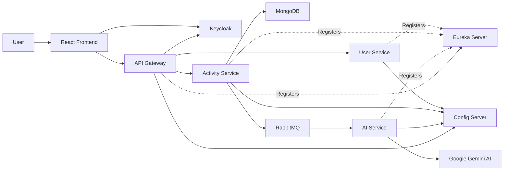

# AI Powered Fitness App Microservices

<p align="center">


</p>

An **AI-powered fitness tracking platform** built using **Spring Boot Microservices**, **Spring Cloud**, **RabbitMQ**, **Keycloak**, **MongoDB**, **React**, and **Google Gemini AI**.

The application enables users to securely track workouts, receive AI-generated fitness recommendations, and demonstrates enterprise-level microservices architecture using asynchronous messaging, centralized configuration, service discovery, and OAuth2 authentication.

## Overview

Fitness App Microservices is a cloud-native fitness tracking platform designed using the Microservices Architecture pattern.

Users can authenticate securely using Keycloak (OAuth2/OpenID Connect), record workout activities, and receive personalized AI-generated recommendations powered by Google Gemini.

The application demonstrates enterprise-level concepts including:

- API Gateway
- Service Discovery
- Centralized Configuration
- Asynchronous Messaging
- Secure Authentication & Authorization
- AI Integration
- Distributed Microservices Communication

The project is intended as both a production-style learning project and a showcase of modern Java Full Stack development.

## Features

### Secure Authentication
- OAuth2/OpenID Connect authentication using Keycloak
- JWT-based authorization
- Role-based access control
- Secure API access through Spring Security

---

### Activity Tracking
- Record workout activities
- Track workout duration
- Monitor calories burned
- Store workout history
- View detailed activity information

---

### AI-Powered Fitness Recommendations
- Event-driven recommendation generation
- Personalized workout analysis
- Performance insights
- Improvement suggestions
- Safety recommendations
- Powered by Google Gemini AI

---

### Microservices Architecture
- API Gateway for request routing
- Eureka Service Discovery
- Spring Cloud Config Server
- Independent microservices
- Scalable architecture
- Loose coupling using RabbitMQ

---

### Event-Driven Communication
- RabbitMQ message broker
- Asynchronous processing
- Reliable event delivery
- Background AI recommendation generation

---

### Data Management
- MongoDB for activity storage
- Persistent recommendation history
- User-specific activity records

---

### Developer Experience
- Swagger/OpenAPI documentation
- Centralized configuration
- RESTful APIs
- Clean layered architecture
- Easy local setup

## Project Highlights

- Enterprise-grade Spring Boot Microservices architecture
- OAuth2 authentication with Keycloak
- API Gateway with centralized routing
- Eureka Service Discovery
- Spring Cloud Config Server
- Event-driven communication using RabbitMQ
- AI-powered fitness recommendations with Google Gemini
- Interactive Swagger API documentation
- Modern React frontend with Material UI

## System Architecture



## Microservices

| Service | Description |
|----------|-------------|
| **API Gateway** | Single entry point for all client requests, routing traffic to the appropriate microservice while enforcing security. |
| **Eureka Server** | Handles service registration and discovery, allowing microservices to communicate dynamically. |
| **Config Server** | Centralized configuration management for all services. |
| **User Service** | Manages user-related operations and validates authenticated users. |
| **Activity Service** | Stores workout activities, validates users, and publishes activity events to RabbitMQ. |
| **AI Service** | Consumes activity events from RabbitMQ, generates personalized fitness recommendations using Google Gemini AI, and stores recommendation history. |
| **Keycloak** | Provides OAuth2/OpenID Connect authentication and JWT token generation. |

## Request Flow

1. The user logs in through **Keycloak**.
2. Keycloak authenticates the user and returns a JWT access token.
3. The React frontend sends authenticated requests through the **API Gateway**.
4. The API Gateway validates the JWT and forwards requests to the appropriate microservice.
5. The **Activity Service** validates the user and stores the workout in MongoDB.
6. After storing the activity, the service publishes an event to **RabbitMQ**.
7. The **AI Service** consumes the event from RabbitMQ.
8. The AI Service sends the workout details to **Google Gemini AI**.
9. Gemini generates personalized recommendations.
10. The recommendation is stored and made available through the API.

## Tech Stack

### Backend


---

### Frontend


---

### Authentication


---

### Databases & Messaging


---

### AI Integration


---

## Project Structure

```text
fitness-app-microservices/
│
├── gateway/                     # API Gateway
├── configServer/                # Spring Cloud Config Server
├── eureka/                      # Eureka Service Registry
├── user-service/                # User Management Service
├── activity-service/            # Activity Tracking Service
├── ai-service/                  # AI Recommendation Service
├── fitness-app-frontend/        # React Frontend
│
├── config/                      # Centralized configuration files
│
├── README.md
└── LICENSE
```

## Service Responsibilities

| Service | Responsibility |
|----------|----------------|
| **Gateway** | Routes incoming requests to the appropriate microservice and secures APIs using JWT. |
| **Config Server** | Provides centralized configuration for all microservices. |
| **Eureka Server** | Registers and discovers microservices dynamically. |
| **User Service** | Handles user validation and user-related operations. |
| **Activity Service** | Stores workout activities, validates users, and publishes events to RabbitMQ. |
| **AI Service** | Consumes activity events, generates AI-powered recommendations using Google Gemini, and stores recommendation history. |
| **React Frontend** | Provides the user interface for authentication, activity tracking, and viewing recommendations. |

## Communication Flow

```text
React Frontend
        │
        ▼
   API Gateway
        │
 ┌──────┴──────┐
 │             │
 ▼             ▼
User       Activity
Service      Service
                 │
                 ▼
             RabbitMQ
                 │
                 ▼
            AI Service
                 │
                 ▼
        Google Gemini AI
```
